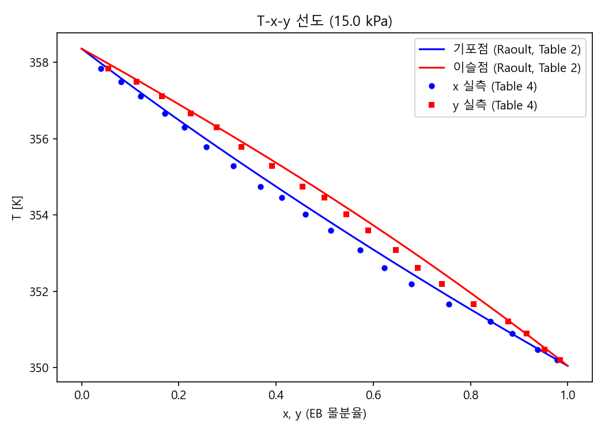
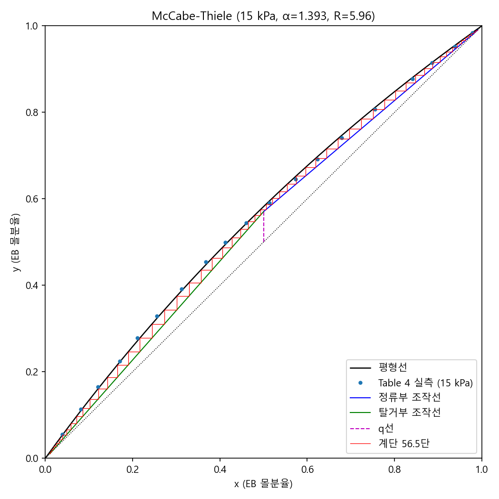

# 에틸벤젠–스티렌 감압 충전 증류탑 설계: 계산 과정

> 이 문서는 `column_design.py`가 하는 계산을 순서대로 풀어 쓴 것이다. 숫자는 모두 코드 실행 결과(`결과/결과요약.md`)와 같다.
> VS Code에서 `Ctrl+Shift+V`(마크다운 미리보기)로 열면 수식이 렌더링된다.
>
> **조성 기준**: 모든 $x, y, z$는 **에틸벤젠(EB, 휘발성이 큰 성분)의 몰분율**이다.

---

## 0. 설계 조건과 데이터 출처

| 항목 | 값 | 출처 |
|---|---|---|
| 공급량 $F$ | 100 kmol/h | 설계 변수 |
| 공급 조성 $z_F$ | 0.50 | 설계 변수 |
| 탑정 조성 $x_D$ / 탑저 조성 $x_B$ | 0.99 / 0.01 | 설계 변수 |
| 공급 상태 $q$ | 1 (포화액) | 설계 변수 |
| 환류비 $R$ | $1.2\,R_{min}$ | 설계 변수 |
| 탑정 압력 $P$ | 15 kPa | 설계 변수 |
| 충전물 / HETP | Mellapak 250Y / 0.385 m | Salem et al. (2008) Table 2 |
| 설계 속도 | 범람 속도의 60 % | 설계 변수 |
| 순성분 증기압 | 실측 $(T, P)$ 표 | Aucejo et al. (2006) Table 2 |
| 이성분 기액평형 | 15 kPa 실측 $(T, x, y)$ 19점 | Aucejo et al. (2006) Table 4 |
| 증발잠열 | EB 39.07, 스티렌 41.5 kJ/mol | NIST WebBook |
| 액체 밀도 $\rho_L$ | 829.7 kg/m³ | Wagner et al. (1997) Table 5 |
| 범람 상관 | Fig. 18.8 (Mellapak 250Y) | 강의 SP3 p14 |
| 압력강하 | 2.31 mbar/m | Salem et al. (2008) Table 3 |

분자량은 $M_{EB} = 106.17$, $M_{ST} = 104.15$ kg/kmol, 기체상수는 $R_g = 8.314$ kPa·m³/(kmol·K)를 쓴다.

---

## 1. 방법 검증: 교재 예제 21.2 재현 (SP6 p30~36)

EB–스티렌 계산에 들어가기 전에, 같은 코드로 강의 예제 21.2(벤젠–톨루엔)를 다시 풀어 교재 답과 비교했다.

- 조건: $F = 350$ kmol/h, $x_F = 0.440$, $x_D = 0.974$, $x_B = 0.0235$, $R = 3.5$, $q = 1$, $\alpha = 2.5$

| 항목 | 코드 | 교재 |
|---|---|---|
| $D$ [kmol/h] | 153.4 | 153.4 |
| 이상단 수 (재비기 포함) | 11.13 | 11 |
| 공급단 | 6 | 7 |

단 수와 공급단이 1단 이내에서 맞는다. 차이는 교재가 실측 평형곡선(Fig. 21.14)을 쓰고, 코드는 $\alpha = 2.5$ 일정으로 근사했기 때문이다.

---

## 2. 물질수지 (SP6 p9)

전체 물질수지와 EB 물질수지

$$
F = D + B, \qquad F z_F = D x_D + B x_B
$$

에서 $B$를 소거하면

$$
\frac{D}{F} = \frac{z_F - x_B}{x_D - x_B}
= \frac{0.50 - 0.01}{0.99 - 0.01} = 0.5
$$

$$
\boxed{D = 50.0\ \text{kmol/h}, \qquad B = 50.0\ \text{kmol/h}}
$$

---

## 3. 기액평형

### 3.1 상대휘발도 (SP6 p4, p25)

상대휘발도는

$$
\alpha = \frac{y/x}{(1-y)/(1-x)}
$$

이고, $\alpha$가 일정하면 평형선은

$$
y = \frac{\alpha x}{1 + (\alpha - 1)x}, \qquad
x = \frac{y}{\alpha - (\alpha - 1)y}
$$

이다.

### 3.2 실측 데이터에서 $\alpha$ 구하기 (주 계산)

Aucejo Table 4의 15 kPa 실측 19점에서 각각 $\alpha_i$를 구하면 1.311 ~ 1.445이다. 양 끝 점은 $y$가 소수 셋째 자리까지만 있어 반올림 오차가 크므로, 점마다 다른 $\alpha$를 쓰지 않고 **기하평균** 하나를 쓴다.

$$
\alpha = \left(\prod_{i=1}^{19} \alpha_i\right)^{1/19} = 1.393
$$

### 3.3 Raoult 법칙으로 구한 $\alpha$ (비교용)

이상 용액이면 Raoult 법칙 $p_i = P_i^{\circ} x_i$에서

$$
\alpha = \frac{P_{EB}^{\circ}(T)}{P_{ST}^{\circ}(T)}
$$

이다. 증기압 $P^{\circ}(T)$는 Table 2 실측값 사이를 $\ln P^{\circ}$ – $1/T$ 직선으로 보간했다.

온도는 기포점과 이슬점 조건으로 구한다.

$$
\text{기포점: } x P_{EB}^{\circ}(T) + (1-x) P_{ST}^{\circ}(T) = P
\qquad
\text{이슬점: } \frac{yP}{P_{EB}^{\circ}(T)} + \frac{(1-y)P}{P_{ST}^{\circ}(T)} = 1
$$

| 위치 | 온도 | $\alpha$ (Raoult) |
|---|---|---|
| 탑정 ($y = 0.99$ 이슬점) | 350.15 K (77.0 °C) | 1.386 |
| 탑저 ($x = 0.01$ 기포점) | 358.26 K (85.1 °C) | 1.367 |

Raoult 모델은 Table 4 실측과 평균 $|\Delta T| = 0.15$ K, $|\Delta y| = 0.0046$ 차이로, 이 계는 거의 이상 용액이다.

---

## 4. 최소환류비 (SP6 p27)

$q = 1$이므로 q선은 $x = z_F$에서 수직선이다. q선과 평형선의 교점은

$$
x' = z_F = 0.5, \qquad
y' = \frac{\alpha x'}{1 + (\alpha - 1)x'} = \frac{1.393 \times 0.5}{1 + 0.393 \times 0.5} = 0.5821
$$

이고, 최소환류비는

$$
R_{min} = \frac{x_D - y'}{y' - x'} = \frac{0.99 - 0.5821}{0.5821 - 0.5} = 4.970
$$

이 계는 거의 이상 용액이라 핀치점이 q선 교점에 생긴다. $R_{min}$에서 조작선이 다른 곳에서 평형선과 만나지 않는지 수치로 확인했다. (평형선 − 조작선)의 최솟값이 $+6.8\times10^{-6}$이므로 다른 접점은 없다.

설계 환류비는

$$
\boxed{R = 1.2\,R_{min} = 1.2 \times 4.970 = 5.964}
$$

---

## 5. 최소 이론단 수 (SP6 p25~26, Fenske 식)

전환류($R \to \infty$)에서 조작선은 $y = x$이고, 이론단 수가 가장 적다.

$$
N_{min} + 1 = \frac{\ln\left[\dfrac{x_D}{1-x_D}\cdot\dfrac{1-x_B}{x_B}\right]}{\ln \alpha}
= \frac{\ln(99 \times 99)}{\ln 1.393} = \frac{9.190}{0.3314} = 27.7
$$

여기서 $+1$은 재비기이므로

$$
N_{min} = 26.7 \ \text{단 (재비기 제외)}
$$

전환류에서 계단 작도로 구해도 27.8단(재비기 포함)으로 Fenske 식과 일치한다.

---

## 6. 조작선과 이론단 수 (SP6 p11~23, McCabe–Thiele)

### 6.1 정류부 조작선

$$
y_{n+1} = \frac{R}{R+1}x_n + \frac{x_D}{R+1}
= \frac{5.964}{6.964}x_n + \frac{0.99}{6.964}
= 0.8564\,x_n + 0.1422
$$

### 6.2 내부 유량

$$
L = RD = 298.2, \quad V = (R+1)D = 348.2 \quad \text{kmol/h}
$$

$$
\bar{L} = L + qF = 398.2, \quad \bar{V} = V - (1-q)F = 348.2 \quad \text{kmol/h}
$$

### 6.3 탈거부 조작선

정류부 조작선과 q선($x = 0.5$)의 교점은 $(0.5,\ 0.5704)$이다. 탈거부 조작선은 이 점과 $(x_B, x_B)$를 지난다.

$$
y_{m+1} = \frac{\bar{L}}{\bar{V}}x_m - \frac{B x_B}{\bar{V}}
= \frac{398.2}{348.2}x_m - \frac{50 \times 0.01}{348.2}
= 1.1436\,x_m - 0.00144
$$

### 6.4 계단 작도

전응축기이므로 $y_1 = x_D = 0.99$에서 시작한다. 각 단에서 평형선으로 $x_n$을 구하고, 조작선으로 다음 단의 $y_{n+1}$을 구하는 과정을 반복한다.

$$
x_n = \frac{y_n}{\alpha - (\alpha-1)y_n}, \qquad y_{n+1} = (\text{조작선})(x_n)
$$

처음 몇 단은 다음과 같다.

| 단 $n$ | $y_n$ | $x_n$ |
|---|---|---|
| 1 | 0.99000 | 0.98613 |
| 2 | 0.98668 | 0.98155 |
| 3 | 0.98278 | 0.97615 |

**공급단 결정**: $x_n$이 q선 교점의 $x$(= 0.5)보다 처음으로 작아지는 단이 공급단이다(SP6 p23). 28단은 $x_{28} = 0.5055$, 29단은 $x_{29} = 0.4928$이므로 **공급단은 위에서 29번째**이다. 그다음 단부터는 탈거부 조작선을 쓴다.

**마지막 단 (소수 단)**: 단 56의 $x = 0.01153$, 단 57의 $x = 0.00846$이다. 단 57에서 $x_B = 0.01$을 지나므로, 마지막 단은 비율로 계산한다.

$$
\text{소수 부분} = \frac{x_{56} - x_B}{x_{56} - x_{57}} = \frac{0.01153 - 0.01}{0.01153 - 0.00846} = 0.50
$$

$$
\boxed{N = 56.5 \text{ 이론단 (재비기 포함)} \;\Rightarrow\; \text{탑 안 } 55.5 \text{단}}
$$

정류부는 28단, 탈거부는 27.5단이다. 공급단은 탈거부에 포함한다(SP6 p8).

비교로 Raoult $\alpha$(Table 2)를 쓰면 $R_{min} = 5.197$, $R = 6.236$, 58.6단이 나온다. 이 경우가 2.1단 더 많아 더 보수적이다.

---

## 7. 열량과 정몰유량 가정 점검 (SP6 p24, SP7 p1~4)

### 7.1 증발잠열

EB는 NIST의 열량계 측정값(Svoboda 1982: 39.5 kJ/mol @ 343 K, 38.6 kJ/mol @ 358 K)을 탑정 온도 350.15 K로 선형 보간했다.

$$
\lambda_{EB} = 39.5 + (38.6 - 39.5)\frac{350.15 - 343}{358 - 343} = 39.07 \ \text{kJ/mol}
$$

스티렌은 증기압에서 유도한 값만 있다(41.5 또는 40.2 kJ/mol). 재비기 열량이 더 크게 나오는 **41.5 kJ/mol**을 썼다.

### 7.2 정몰유량 가정 점검

$$
\frac{\lambda_{ST}}{\lambda_{EB}} = \frac{41.5}{39.07} = 1.062
$$

두 잠열이 6 % 다르다. 강의의 정몰유량 가정(잠열이 거의 같음)이 근사적으로만 성립하므로 한계로 기록한다.

### 7.3 응축기·재비기 열량

혼합물 잠열은 몰분율 가중평균으로 구한다.

$$
\lambda_{top} = 0.99(39.07) + 0.01(41.5) = 39.09, \qquad
\lambda_{bot} = 0.01(39.07) + 0.99(41.5) = 41.48 \ \text{kJ/mol}
$$

$$
Q_c = V\lambda_{top} = \frac{348.2 \times 1000 \times 39.09}{3600} = \boxed{3781\ \text{kW}}
$$

$$
Q_r = \bar{V}\lambda_{bot} = \frac{348.2 \times 1000 \times 41.48}{3600} = \boxed{4011\ \text{kW}}
$$

현열($c_p\Delta T$)은 무시했다. 탑 전체 온도차가 약 8 K, 단당 약 0.15 K라서 잠열 대비 0.1 % 미만이다.

---

## 8. 범람 속도와 탑 직경 (SP3 p11~14, 예제 21.6 방식)

### 8.1 증기 밀도 (이상기체)

$$
\rho_V = \frac{P M_V}{R_g T}
$$

- 탑정: $M_V = 0.99(106.17) + 0.01(104.15) = 106.15$ 이므로

$$
\rho_V = \frac{15 \times 106.15}{8.314 \times 350.15} = 0.547 \ \text{kg/m}^3
$$

- 탑저: 재비기 증기는 $y_B = \alpha x_B / (1 + (\alpha-1)x_B) = 0.0139$, $M_V = 104.18$ 이므로

$$
\rho_V = \frac{15 \times 104.18}{8.314 \times 358.26} = 0.525 \ \text{kg/m}^3
$$

### 8.2 Fig. 18.8 의 가로축 (유동 인자)

$$
X = \frac{G_x}{G_y}\sqrt{\frac{\rho_y}{\rho_x}} = \frac{L M_L}{V M_V}\sqrt{\frac{\rho_V}{\rho_L}}
$$

- 탑정: $X = \dfrac{298.2}{348.2}\sqrt{\dfrac{0.547}{829.7}} = 0.8564 \times 0.02568 = 0.0220$
- 탑저: $X = \dfrac{398.2 \times 104.17}{348.2 \times 104.18}\sqrt{\dfrac{0.525}{829.7}} = 0.0288$

### 8.3 범람 속도

Fig. 18.8의 Mellapak 250Y 곡선에서 판독한 점 사이를 $\log X$에 대해 선형 보간해 세로축 값 $Y$를 읽는다.

$$
Y = u_{0,f}\sqrt{\frac{\rho_y}{\rho_x - \rho_y}}
\quad\Rightarrow\quad
u_f = \frac{Y}{\sqrt{\rho_V / (\rho_L - \rho_V)}}
$$

예를 들어 탑정은 $X = 0.0220$이 판독점 $(0.0135,\ 0.116)$과 $(0.029,\ 0.108)$ 사이에 있다.

$$
t = \frac{\log 0.0220 - \log 0.0135}{\log 0.029 - \log 0.0135} = 0.639, \qquad
Y = 0.116 - 0.008 \times 0.639 = 0.1109 \ \text{m/s}
$$

$$
u_f = \frac{0.1109}{\sqrt{0.547/(829.7 - 0.547)}} = 4.32 \ \text{m/s}
$$

### 8.4 설계 속도와 직경

설계 속도는 범람의 60 %이다.

$$
u = 0.60\,u_f, \qquad
Q_V = \frac{V M_V}{3600\,\rho_V}\ [\text{m}^3/\text{s}], \qquad
A = \frac{Q_V}{u}, \qquad
D_c = \sqrt{\frac{4A}{\pi}}
$$

| 위치 | $\rho_V$ | $X$ | $Y$ | $u_f$ [m/s] | $u$ [m/s] | $Q_V$ [m³/s] | $D_c$ [m] |
|---|---|---|---|---|---|---|---|
| 탑정 | 0.547 | 0.0220 | 0.1109 | 4.32 | 2.59 | 18.8 | 3.04 |
| 탑저 | 0.525 | 0.0288 | 0.1081 | 4.30 | 2.58 | 19.2 | 3.08 |

두 위치 중 큰 값을 택한다.

$$
\boxed{D_c = 3.08 \ \text{m} \;\rightarrow\; 3.1\ \text{m}}
$$

F-factor는 $F = u\sqrt{\rho_V} \approx 1.9$ Pa$^{0.5}$이다.

---

## 9. 충전 높이 (McCabe 21.6)

교재에 따르면 충전탑 높이는 이론단 수와 HETP로 정하고, 평균 HETP는 $H_{Oy}$와 거의 같다.

$$
Z = N \times \text{HETP}, \qquad \text{HETP} \approx H_{Oy}
$$

$$
Z_{rect} = 28 \times 0.385 = 10.78\ \text{m}, \qquad
Z_{strip} = 27.5 \times 0.385 = 10.59\ \text{m}
$$

$$
\boxed{Z = 21.4\ \text{m}}
$$

긴 탑은 3~4 m마다 재분배기를 둔다(McCabe 21.6). 한 층을 4 m 이하로 하면 정류부 3층, 탈거부 3층으로 총 6층이다. 분배기, 지지대, 탑저 여유 높이는 강의 근거가 없어 포함하지 않았다.

| HETP [m] | 0.30 | **0.385** | 0.50 | 0.60 |
|---|---|---|---|---|
| $Z$ [m] | 16.6 | **21.4** | 27.7 | 33.3 |

---

## 10. 압력강하 점검 (설계 후)

McCabe–Thiele은 탑 전체 압력이 일정하다고 가정한다. 설계가 끝난 뒤 실제 압력강하를 어림한다.

$$
\Delta P = 2.31\ \text{mbar/m} \times 21.37\ \text{m} = 49.4\ \text{mbar} = 4.94\ \text{kPa}
$$

$$
P_{bottom} = 15 + 4.94 = 19.94\ \text{kPa}
$$

이 압력에서 $x_B = 0.01$의 기포점을 다시 구하면

$$
T_{bottom} = 365.9\ \text{K} = \boxed{92.7\ ^{\circ}\text{C}} \quad (< 100\ ^{\circ}\text{C})
$$

이다. 2.31 mbar/m는 F-factor 2.4 조건의 실측값이다. 우리 탑은 F ≈ 1.9로 증기 부하가 더 작으므로, 이 압력강하는 다소 크게 잡은(보수적인) 값이다.

---

## 11. 단별 압력 보정 (균일 압력 가정 해제)

실제로는 아래 단으로 갈수록 압력이 높아지고 $\alpha$가 작아진다. 이론단 한 단당 압력 상승은

$$
\Delta P_{stage} = 2.31\ \text{mbar/m} \times 0.385\ \text{m} = 0.0889\ \text{kPa/단}
$$

이다. $n$번째 단의 압력과 평형은

$$
P_n = P_{top} + (n-1)\,\Delta P_{stage}
$$

$$
\frac{y_n P_n}{P_{EB}^{\circ}(T_n)} + \frac{(1-y_n) P_n}{P_{ST}^{\circ}(T_n)} = 1
\;\Rightarrow\; T_n,
\qquad
x_n = \frac{y_n P_n}{P_{EB}^{\circ}(T_n)}
$$

로 구한다. 조작선(정몰유량)은 그대로 두고 6.4절처럼 계단 작도를 반복한다.

| 계산 | 이론단 (재비기 포함) | 충전 높이 [m] | 탑저 압력 / 온도 |
|---|---|---|---|
| 실측 $\alpha$, 균일 압력 (주 설계) | 56.5 | 21.4 | 19.9 kPa / 92.7 °C (점검값) |
| Raoult $\alpha$, 균일 압력 | 58.6 | 22.2 | 15.0 kPa / 85.1 °C |
| **Raoult $\alpha$ + 단별 압력** | **61.6** | **23.3** | 20.4 kPa / 93.4 °C |
| 실측 $\alpha$ + 압력 효과 비율 (추정) | 59.4 | 22.5 | – |

$\alpha$는 탑정 1.386에서 탑저 1.351로 줄어든다. 그 결과 단수가 약 3단(+5 %) 늘고, 공급단은 30번째로 한 칸 내려간다. 즉 균일 압력 가정은 단수를 약 5 % 적게 준다. 최소환류비는 탑정 압력 기준 그대로 두었다.

---

## 12. 결과 요약

| 항목 | 결과 |
|---|---|
| $D$, $B$ | 50, 50 kmol/h |
| $\alpha$ (15 kPa, 실측 기하평균) | 1.393 |
| $R_{min}$ / $R$ | 4.970 / 5.964 |
| $N_{min}$ (Fenske, 재비기 제외) | 26.7 |
| 이론단 | 56.5 (재비기 포함), 탑 안 55.5단, 공급단 위에서 29번째 |
| $Q_c$ / $Q_r$ | 3781 / 4011 kW |
| 탑 직경 | 3.1 m |
| 충전 높이 | 21.4 m (단별 압력 보정 시 22.5~23.3 m) |
| 탑저 | 19.9~20.4 kPa, 92.7~93.4 °C |

**DWSIM 검증 요약** (`결과/DWSIM검증.md`)
- 같은 조건(56단 + 응축기 + 재비기, $R = 5.964$)에서 DWSIM 결과는 $x_D = 0.9951$, $x_B = 0.0049$로 목표보다 더 잘 분리된다.
- 열량은 $Q_c$ +0.4 %, $Q_r$ −5.1 % 차이이고, 온도는 ±0.6 K 안에서 맞는다.
- 차이의 원인은 DWSIM의 $\alpha$(1.424)가 실측값(1.393)보다 크기 때문이다. 같은 $\alpha$를 넣으면 두 방법의 단수 차이는 1.9 %이다.

**가정과 한계**
1. 정몰유량: 잠열 차이 6 %, 현열은 0.1 % 미만이다.
2. 균일 압력: 단별 압력 보정 시 +5 %이다(11절).
3. HETP: 산업 탑 한 곳의 값을 그대로 썼다. 경험식으로 추정하면 0.40~0.53 m이다.
4. 압력강하: 다른 F-factor 조건의 실측값을 썼다(보수적).
